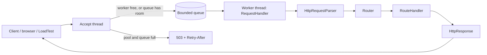

# Multithreaded Web Server

A small HTTP/1.1 server written from scratch on plain Java sockets (`java.net`) with a bounded worker thread pool, plus a command-line HTTP client and a small load tester. No frameworks, no runtime dependencies.

It is an **educational project**: the goal is to show, in a codebase small enough to read in one sitting, how a server accepts connections, parses HTTP, enforces limits, handles concurrency, and shuts down cleanly.

> **Status.** Not security-audited, not load-tested, and **not production-ready**. See [Limitations](#limitations). The automated tests check correctness and bounded behavior; they make no performance claims.

## Contents

- [What is in the project](#what-is-in-the-project)
- [Prerequisites](#prerequisites)
- [Build and test](#build-and-test)
- [Running the server](#running-the-server)
- [Routes](#routes)
- [The client](#the-client)
- [The load test](#the-load-test)
- [Server configuration](#server-configuration)
- [Architecture](#architecture)
- [Design choices](#design-choices)
- [Error responses](#error-responses)
- [Limitations](#limitations)
- [Testing](#testing)
- [Project layout](#project-layout)
- [Maven Wrapper](#maven-wrapper)

## What is in the project

| Part | Class | What it is |
|------|-------|------------|
| Server | `Main`, `Server` | Accepts connections, serves the demo routes with a bounded worker pool, shuts down gracefully. |
| Client | `tools.Client` | Command-line HTTP client: sends one request, prints the response. |
| Load test | `tools.LoadTest` | Starts N concurrent clients together and reports successes, failures, time, throughput and latency. |

The client and the load test share one socket-level HTTP client (`tools.RawHttpClient`), so what the load test measures is the same thing the client sends.

## Prerequisites

- **JDK 17 or newer.** The code targets Java 17 (`maven.compiler.release` is 17) and is developed and tested with JDK 21.
- **Maven**, or nothing extra once the [Maven Wrapper](#maven-wrapper) files are present in your checkout (the wrapper downloads Maven on first use, so that run needs internet access).

```powershell
java -version
```

## Build and test

Commands are for Windows PowerShell, run from the folder containing `pom.xml`. If the Maven Wrapper files are present, use `.\mvnw.cmd` instead of `mvn` (on macOS or Linux: `./mvnw`).

```powershell
# Compile and run all tests
mvn clean verify

# Build the runnable jar (this also runs the tests)
mvn clean package
```

The jar is `target\multithreaded-web-server-1.0.0-SNAPSHOT.jar`. It contains the server, the client and the load test and has no dependencies.

## Running the server

```powershell
# Default: 127.0.0.1:8010, 10 worker threads, queue of 100
java -jar target\multithreaded-web-server-1.0.0-SNAPSHOT.jar

# With options
java -jar target\multithreaded-web-server-1.0.0-SNAPSHOT.jar --port 9090 --threads 4 --queue 20

# All options
java -jar target\multithreaded-web-server-1.0.0-SNAPSHOT.jar --help
```

**Startup.** The server binds the address and port, then logs `Listening on 127.0.0.1:8010 (workers=10, queue=100)`. If the port is already in use it prints an error and exits with code 1. By default it listens on loopback only; `--host 0.0.0.0` listens on all interfaces and logs a warning.

**Shutdown.** Press `Ctrl+C`. The server then:

1. closes the listening socket, so no new connections are accepted;
2. lets running and queued requests finish, for up to `--shutdown-timeout-s` seconds (default 5);
3. if any remain, interrupts the workers and closes their sockets (forced shutdown);
4. prints `Server stopped.`

Shutdown is safe to trigger more than once. A stopped server cannot be restarted in the same process.

## Routes

These are demonstration routes (see `DemoRoutes.java`).

| Method | Path | Status | Response body |
|--------|------|--------|---------------|
| GET | `/hello` | 200 | `Hello from my Java web server!` |
| GET | `/health` | 200 | `Server is healthy` |
| GET | `/users` | 200 | `User 1`, `User 2`, `User 3` on separate lines. **A fixed, hard-coded list.** |
| POST | `/users` | 201 | `User created successfully: ` followed by the request body. **A stub.** |

All responses are `text/plain; charset=utf-8`.

**`POST /users` is a stub.** It echoes the request body back with status 201. It does not parse or validate JSON, does not store anything (there is no database, file, or in-memory store), and does not change what `GET /users` returns. The message "User created successfully" describes the demo, not real behavior: no user is created. The stub exists to demonstrate request-body handling and byte-exact `Content-Length` handling.

Anything else: an unknown path returns `404 Route not found`; a known path with another method (for example `DELETE /users`) returns `405 HTTP method not allowed for this route` with `Allow: GET, POST`. `HEAD` and `OPTIONS` are not implemented and return 405.

Adding a route takes one line:

```java
Router router = DemoRoutes.create();
router.get("/time", request -> HttpResponse.text(HttpStatus.OK, java.time.Instant.now().toString()));
new Server(ServerConfig.defaults(), router).start();   // start() throws IOException if the port is taken
```

## The client

`Client` sends one HTTP/1.1 request and prints the response. It is built on sockets, needs no dependencies, and always sends `Host`, `Content-Length` (counted in UTF-8 bytes, when there is a body), and `Connection: close`. The body is written as raw bytes: nothing, not even a newline, is added.

Run it from the jar (start the server first, in another window):

```powershell
$jar = "target\multithreaded-web-server-1.0.0-SNAPSHOT.jar"

# GET /hello (the default request)
java -cp $jar com.sathwik.webserver.tools.Client

# Other paths and ports
java -cp $jar com.sathwik.webserver.tools.Client --port 9090 --path /health

# POST with a body (a body alone makes the method POST)
java -cp $jar com.sathwik.webserver.tools.Client --path /users --content-type application/json --body-file body.json

# A method the server does not allow: prints the 405 response and exits with code 1
java -cp $jar com.sathwik.webserver.tools.Client --method DELETE --path /users

# Only the response body, with a custom header
java -cp $jar com.sathwik.webserver.tools.Client --path /hello --no-headers --header "X-Request-Id: 42"
```

Example output:

```
HTTP/1.1 200 OK
Connection: close
Content-Length: 30
Content-Type: text/plain; charset=utf-8
X-Content-Type-Options: nosniff

Hello from my Java web server!
```

Response headers are printed sorted by name, not in the order the server sent them.

| Option | Default | Meaning |
|--------|---------|---------|
| `--host` | `127.0.0.1` | Server host |
| `--port` | `8010` | Server port |
| `--method` | `GET` (`POST` if a body is given) | HTTP method |
| `--path` | `/hello` | Path and query string; must already be percent-encoded ASCII |
| `--body <text>` | none | Request body, sent as UTF-8 bytes |
| `--body-file <file>` | none | Request body read from a file (up to 10 MiB), sent byte-for-byte |
| `--content-type` | `text/plain; charset=utf-8` when there is a body | `Content-Type` header |
| `--header "Name: value"` | none | Extra header; may be repeated. `Host`, `Content-Length`, `Connection` and `Transfer-Encoding` cannot be set. |
| `--connect-timeout-ms` | `3000` | Connect timeout |
| `--read-timeout-ms` | `5000` | Longest a single read may block |
| `--total-timeout-ms` | `30000` | Longest the whole request may take |
| `--max-response-bytes` | `10485760` | Larger response bodies are rejected |
| `--no-headers` | off | Print only the response body |

**Exit codes.** `0` the response was 2xx; `1` a response was received but was not 2xx; `2` invalid command line; `3` connection, timeout or protocol failure. Errors are explained on stderr, for example `Error: request to 127.0.0.1:8010 failed: Connection failed: Connection refused`.

**Non-ASCII text on the command line.** The JVM decodes command-line arguments with the operating system's code page, so characters outside that code page can be altered *before* the client sees them (this is most likely on Windows). The client itself encodes `--body` as UTF-8. For bodies with non-ASCII characters use `--body-file` with a UTF-8 file, which is sent byte-for-byte.

**Safe output.** Control characters from the server (other than tab and line breaks) are replaced with `?` before printing, so a misbehaving server cannot send terminal escape sequences.

## The load test

`LoadTest` starts concurrent clients that are all released together, sends requests, and reports what happened.

```powershell
$jar = "target\multithreaded-web-server-1.0.0-SNAPSHOT.jar"

# Default: 20 concurrent clients, one GET /hello each, against 127.0.0.1:8010
java -cp $jar com.sathwik.webserver.tools.LoadTest

# More load: 100 clients, 10 sequential requests each (1000 requests)
java -cp $jar com.sathwik.webserver.tools.LoadTest --clients 100 --requests-per-client 10

# Another host, port and path
java -cp $jar com.sathwik.webserver.tools.LoadTest --host localhost --port 9090 --path /health --clients 50

# POST to the demo stub
java -cp $jar com.sathwik.webserver.tools.LoadTest --path /users --body "hello" --clients 10
```

Example output (numbers will differ on your machine):

```
Starting 20 client(s), 1 request(s) each, against 127.0.0.1:8010/hello ...
Load test results
  Target:                       GET http://127.0.0.1:8010/hello
  Clients:                      20 concurrent, 1 request(s) each
  Total requests:               20
  Successful (2xx):             20
  HTTP failures (non-2xx):      0
  Connection/protocol failures: 0
  Status codes:                 200 x20
  Elapsed:                      66.4 ms
  Throughput:                   301.3 requests/s
  Latency (responses only):     avg 40.00 ms, min 22.40 ms, max 60.26 ms
  Result:                       PASSED

Note: a small single-machine check, not a production-grade benchmark. ...
```

| Option | Default | Meaning |
|--------|---------|---------|
| `--host` | `127.0.0.1` | Server host |
| `--port` | `8010` | Server port |
| `--path` | `/hello` | Request path |
| `--method` | `GET` (`POST` if `--body` is given) | HTTP method |
| `--body <text>` | none | Request body (UTF-8) |
| `--content-type` | `text/plain; charset=utf-8` when there is a body | `Content-Type` header |
| `--clients` | `20` | Concurrent clients, 1 to 1000 |
| `--requests-per-client` | `1` | Sequential requests per client, 1 to 10000 (clients x requests must not exceed 1,000,000) |
| `--connect-timeout-ms` | `3000` | Connect timeout |
| `--read-timeout-ms` | `5000` | Longest a single read may block |

### What it measures

- **Bounded threads.** One fixed pool with exactly `--clients` threads (never more than 1000). Nothing is created per request.
- **Starting together.** Every worker thread reports ready, then waits at a latch. The main thread releases them all at once and starts the clock.
- **Monotonic clock.** Elapsed time and latency use `System.nanoTime()`, which is not affected by wall-clock changes.
- **Every request is classified into exactly one outcome:**

| Metric | Meaning |
|--------|---------|
| Total requests | `clients x requests-per-client`, the number planned |
| Successful (2xx) | A complete HTTP response with a 2xx status |
| HTTP failures (non-2xx) | A complete HTTP response with any other status: 3xx, 4xx, 5xx, including the server's own `503` when it is overloaded |
| Connection/protocol failures | No usable response: connection refused or reset, timeout, or a malformed, truncated or oversized response. The most common reasons are listed by name. |
| Not completed | Only shown if the run was interrupted before every request finished |
| Status codes | How many responses carried each status code |
| Elapsed | From the moment all clients are released until the last request finishes |
| Throughput | Finished requests (including failed ones) divided by elapsed seconds |
| Latency | Per request, from before connecting until the whole response is read. Averaged, with min and max, **only over requests that received a response**, because the time until a connection fails says nothing about how fast the server answers |

**Exit codes.** `0` every request returned 2xx; `1` any connection failure, any non-2xx response, any request that did not complete, or an interrupted run; `2` invalid command line. If the thread running the test is interrupted (when you call `LoadTest.execute` from your own code), the workers are stopped and a partial report is returned. Pressing `Ctrl+C` in the command-line tool simply ends the process without a report; its worker threads are daemon threads, so nothing is left running.

### Reading the numbers honestly

This is a **small functional check, not a benchmark**. It runs on one machine, usually against loopback, so the load generator and the server compete for the same CPUs; it uses a new connection for every request; the first requests include JVM warm-up; and a run of 20 requests lasts a few milliseconds. Do not quote the throughput or latency as server capacity. What it is good for: confirming that the server answers many simultaneous clients correctly, and seeing overload behavior (for example, start the server with `--threads 1 --queue 1` and run the load test to see `503` responses counted as HTTP failures).

## Server configuration

Settings live in `ServerConfig` (an immutable object created with a validating builder). `Main` exposes them as options, written `--name value` or `--name=value`.

| Option | Default | Meaning |
|--------|---------|---------|
| `--host` | `127.0.0.1` | Address to bind. Use `0.0.0.0` for all interfaces. |
| `--port` | `8010` | TCP port. `0` lets the OS pick a free port. |
| `--threads` | `10` | Worker threads, so the maximum number of requests handled at once. |
| `--queue` | `100` | Connections allowed to wait for a free worker. |
| `--read-timeout-ms` | `5000` | Longest a single socket read may block. |
| `--request-timeout-ms` | `15000` | Longest allowed to receive a complete request. |
| `--write-timeout-ms` | `10000` | Longest allowed to write one response. |
| `--max-request-line-bytes` | `8192` | Request line limit. |
| `--max-header-bytes` | `16384` | Total header size limit. |
| `--max-header-count` | `100` | Maximum number of headers. |
| `--max-body-bytes` | `1048576` | Request body limit (1 MiB). |
| `--shutdown-timeout-s` | `5` | Grace period before forced shutdown. |

## Architecture



| Class | Responsibility |
|-------|----------------|
| `Main` | Command-line entry point: parses options, starts the server, installs the shutdown hook. |
| `Server` | Lifecycle (`start`, `stop`), the accept loop, the bounded worker pool, overload handling, graceful and forced shutdown. |
| `RequestHandler` | Handles one connection: parse, route, respond, close. Maps failures to HTTP status codes. |
| `HttpRequestParser` | Byte-level HTTP/1.1 request parser with size and time limits. Reports problems as `HttpParseException` carrying the right status. |
| `Router`, `RouteHandler` | Thread-safe method and path routing; the handler interface for one route. |
| `DemoRoutes` | The four demonstration routes. |
| `HttpRequest`, `HttpResponse`, `HttpStatus` | Immutable request and response values and the status codes in use. |
| `ServerConfig` | Immutable, validated settings. |
| `Sockets`, `HttpSyntax` | Small package-private helpers. |
| `tools.RawHttpClient` | Socket-level HTTP client with timeouts and strict response parsing; used by `Client` and `LoadTest`. |
| `tools.Client` | The command-line client. |
| `tools.LoadTest`, `tools.LoadTestMetrics` | The load tester and its thread-safe result recorder. |
| `tools.CommandLine` | Shared `--name value` option parser. |

### Request lifecycle (server)

1. The **accept thread** accepts the socket and submits a `RequestHandler` to the pool. If the pool and queue are full, it answers `503` itself and closes the connection.
2. A **worker** sets the read timeout; `HttpRequestParser` reads the request, enforcing the size limits and the overall request deadline.
3. The `Router` finds the handler and produces an `HttpResponse`. A handler that throws becomes a generic `500`.
4. The response is written through a buffer (with a write watchdog) and the socket is closed.

### Request lifecycle (client and load test)

1. `RawHttpClient` builds the request as exact bytes and connects with a connect timeout.
2. It writes the request, then reads the status line, headers and body with per-read and total time limits and a size limit.
3. `Client` prints the response. `LoadTest` records the status code and latency (or the failure) in `LoadTestMetrics`.

### Threads (server)

- **1 accept thread** that only accepts connections and hands them off.
- **`--threads` worker threads** that each handle one connection at a time.
- **1 watchdog thread** that closes sockets whose response write has stalled.

### Overload policy

At most `--threads` requests run at once and at most `--queue` wait. When both are full, the accept thread immediately answers `503 Service Unavailable` with `Retry-After: 1`, closes the connection, and counts it. Connections are never dropped silently, and the number of open client sockets is bounded by `threads + queue`.

## Design choices

- **Parse bytes, not characters.** `Content-Length` counts bytes, so both the server parser and the client work on bytes and decode bodies as strict UTF-8.
- **Every resource has a limit.** Server: threads, queue, request line, header bytes and count, body size, read, request and write time. Client and load test: connect, read and total time, response size, and thread count.
- **Thread-per-connection with a fixed pool.** Simple, easy to reason about and to test. Its weakness is described under [Limitations](#limitations).
- **Reject, don't queue forever.** A bounded queue plus an explicit 503 gives clients a clear signal and protects the server.
- **Strict parsing on both sides.** The server rejects obsolete line folding, whitespace before a header colon, invalid percent-encoding, control characters, duplicate `Host` or `Content-Length`, and `Transfer-Encoding`. The client rejects malformed status lines and headers, bad `Content-Length`, truncated bodies and chunked responses instead of guessing.
- **One response per connection.** `Connection: close` keeps the state machine trivial. There is no keep-alive and no pipelining.
- **Error isolation.** A failing route handler becomes a generic `500` (details only in the log); a vanished client is logged quietly; one connection can never take down the server.
- **Lingering close after errors.** After an error response the server half-closes and briefly discards unread input (at most 64 KiB for at most 1 second), so the client can read the error instead of seeing a connection reset.
- **Loopback by default.** The server binds to `127.0.0.1` unless told otherwise.
- **Logging.** Standard `java.util.logging`, one `INFO` line per request (method, path, status, duration). Query strings, headers and bodies are deliberately not logged.

## Error responses

| Status | When |
|--------|------|
| 400 Bad Request | Malformed request line, header, percent-encoding, or `Content-Length`; missing `Host`; incomplete body; body that is not valid UTF-8; empty request |
| 404 Not Found | No route for the path |
| 405 Method Not Allowed | Path exists but not for this method (`Allow` header included) |
| 408 Request Timeout | A read timed out, or the whole request took longer than `--request-timeout-ms` |
| 413 Payload Too Large | `Content-Length` above `--max-body-bytes` (rejected before reading the body) |
| 414 URI Too Long | Request line above `--max-request-line-bytes` |
| 431 Request Header Fields Too Large | Too many headers, or headers too large |
| 500 Internal Server Error | A route handler threw an exception or returned nothing |
| 501 Not Implemented | `Transfer-Encoding` (for example chunked bodies) |
| 503 Service Unavailable | Worker pool and queue full, or the server is shutting down |
| 505 HTTP Version Not Supported | Any version other than `HTTP/1.1` |

## Limitations

This list is intentionally blunt.

**Server**

- **No TLS, authentication, authorization, or rate limiting.** Do not expose it to untrusted networks.
- **Slow clients can still occupy workers.** Each connection holds a thread until it finishes or times out. The timeouts bound this, but a flood of slow connections can still starve the pool for up to roughly the read and request timeouts. Event-driven designs (NIO, virtual threads) handle this better.
- **No keep-alive, pipelining, chunked request bodies, HTTP/2, compression, or static file serving.**
- **`Expect: 100-continue` is not handled.** Some clients wait briefly before sending a body.
- **Only origin-form request targets** (`/path?query`) are accepted.
- **`HEAD` and `OPTIONS` are not implemented.** They return 405. For `HEAD`, the 405 response currently includes a message body, which HTTP says a `HEAD` response must not have.
- **Bodies are assumed to be UTF-8.** A `charset` in the request `Content-Type` is ignored.
- **No persistence.** `POST /users` is a stub (see [Routes](#routes)).
- **Late log lines.** The JDK's logging cleanup can swallow `java.util.logging` output written during JVM shutdown, which is why `Main` prints `Server stopped.` itself.

**Client and load test**

- **Plain HTTP only** (no TLS), one request per connection, no redirects, no cookies.
- **Responses with `Transfer-Encoding` (for example chunked) are rejected**, and interim `1xx` responses are reported as the response rather than skipped.
- **The load test is not a benchmark** (see [Reading the numbers honestly](#reading-the-numbers-honestly)). It has no percentile latencies, no warm-up phase, and no ramp-up.
- **Workers blocked in a socket call cannot be interrupted.** After an interrupt they finish when their connect or read timeout expires, which bounds the wait.

**Project**

- **Not load-tested or security-tested.** The tests check correctness on a developer machine.
- **Timing-based tests.** A few tests use short timeouts. They are generous, but an extremely slow or overloaded CI machine could make one flaky.

## Testing

```powershell
mvn clean verify
```

The suite uses JUnit 5. Integration tests start real servers on OS-assigned ports (`--port 0`), so they do not collide with anything running on your machine.

| Test class | Covers |
|------------|--------|
| `HttpRequestParserTest` | Parsing, decoding, header rules, every limit and rejection, timeouts and the request deadline |
| `HttpResponseTest` | Exact wire format, CRLF, UTF-8 `Content-Length`, header-injection protection |
| `ServerConfigTest` | Defaults and validation |
| `RouterTest` | 404 and 405 behavior, the `Allow` header, registration rules |
| `DemoRoutesTest` | The four demo routes, including that `POST /users` stores nothing |
| `MainTest` | Server command-line option parsing |
| `ServerIntegrationTest` | Real sockets: all routes, malformed and oversized requests, slow and vanishing clients, write timeouts, failing handlers, concurrent clients, the 503 overload policy, graceful and forced shutdown |
| `tools.CommandLineTest` | Shared option parsing |
| `tools.ClientOptionsTest` | Client option parsing, defaults, validation, body files, header rules |
| `tools.RawHttpClientTest` | Status-line parsing, exact request bytes (UTF-8 length, no trailing newline), strict response parsing, truncated, oversized, chunked and garbage responses, read, total and connect failures, against a fake socket server |
| `tools.ClientTest` | The client against a real server: GET and POST, 404 and 405, exit codes, timeouts, protocol errors, terminal-escape neutralization |
| `tools.LoadTestMetricsTest` | Status classification, aggregation, latency statistics, failure grouping, exact totals under 8 concurrent threads |
| `tools.LoadTestOptionsTest` | Load-test defaults, validation, and the bounds on threads and total work |
| `tools.LoadTestTest` | The load test against real servers: successes, HTTP failures, connection failures, 503 overload, clients released together (a barrier that only opens if all are in flight at once), thread count equals client count, interruption and cleanup, report text and exit codes |

`ServerIntegrationTest` includes one test that allocates a 64 MiB response to exercise the write timeout, so the test JVM needs roughly 200 MB of heap.

## Project layout

```
.
├── pom.xml
├── README.md
├── .gitignore
├── mvnw, mvnw.cmd, .mvn/        Maven Wrapper (generated by Maven; see below)
└── src
    ├── main/java/com/sathwik/webserver
    │   ├── Main.java, Server.java, RequestHandler.java
    │   ├── HttpRequestParser.java, Router.java, RouteHandler.java, DemoRoutes.java
    │   ├── HttpRequest.java, HttpResponse.java, HttpStatus.java, HttpParseException.java
    │   ├── ServerConfig.java, Sockets.java, HttpSyntax.java
    │   └── tools
    │       ├── Client.java, LoadTest.java, LoadTestMetrics.java
    │       └── RawHttpClient.java, CommandLine.java
    └── test/java/com/sathwik/webserver
        ├── (server tests and TestHttpClient)
        └── tools
            └── (client and load-test tests and FakeServer)
```

## Maven Wrapper

The Maven Wrapper lets anyone build the project with only a JDK installed. Its files (`mvnw`, `mvnw.cmd`, and `.mvn/wrapper/`) are generated by Maven itself, never written by hand:

```powershell
mvn -N wrapper:wrapper
```

Run that once, in the folder that contains `pom.xml`, with Maven installed. Then verify and commit the generated files:

```powershell
.\mvnw.cmd -v
.\mvnw.cmd clean verify
git add mvnw mvnw.cmd .mvn
```

The Maven version the wrapper uses is recorded in `.mvn/wrapper/maven-wrapper.properties`.
